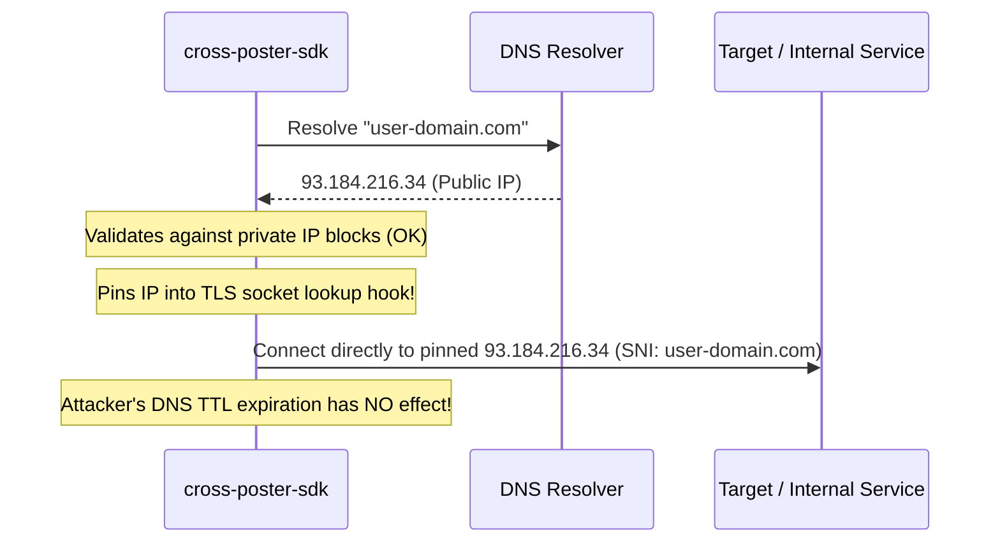

# cross-poster-sdk

[](https://github.com/takao-dev/cross-poster-sdk/actions/workflows/ci.yml)
[](https://codecov.io/gh/takao-dev/cross-poster-sdk)
[](https://github.com/takao-dev/cross-poster-sdk/actions/workflows/codeql.yml)
[](https://www.npmjs.com/package/cross-poster-sdk)
[](https://opensource.org/licenses/MIT)

> **Zero-dependency, multi-SNS cross-posting SDK for X (Twitter), Mastodon, Bluesky (AT Protocol), Misskey, and Meta Threads, engineered with DNS-rebinding-safe SSRF defense and AES-256-GCM credential envelopes.**

Cross-posting across federated (Mastodon, Misskey) and centralized (X, Bluesky, Threads) networks introduces severe security hazards: users supply arbitrary instance domains that can target internal cloud metadata endpoints (`169.254.169.254`) or trigger DNS rebinding attacks. `cross-poster-sdk` provides an all-in-one unified cross-posting pipeline with rock-solid security defaults and **zero external npm dependencies**.

---

## Features

- **Unified 5-Network Adapter**:
  Post and delete across **X (v2 API)**, **Mastodon (v1 API)**, **Bluesky (AT Protocol / XRPC)**, **Misskey (Notes API)**, and **Threads (2-step container API)** through a single clean interface.
- **DNS-Rebinding-Proof SSRF Protection**:
  Validates destination addresses against private/internal IPv4 and IPv6 CIDR blocks (RFC1918, CGNAT, Loopback, Link-Local, Cloud Metadata, 6to4, IPv4-mapped IPv6). Resolves and **pins the IP address** directly into the Node.js socket TLS handshake (`lookup` hook), completely eliminating Time-Of-Check to Time-Of-Use (TOCTOU) DNS rebinding attacks.
- **AES-256-GCM Credential Envelopes**:
  Built-in `v1.<iv>.<tag>.<ciphertext>` authenticated encryption helpers for securely storing OAuth tokens and app passwords at rest in your database.
- **Dry-Run Simulation Mode**:
  Test your cross-posting workflows locally without touching live APIs or burning rate limits.
- **Zero Runtime Dependencies**:
  Built exclusively on Node.js core modules (`node:https`, `node:dns/promises`, `node:net`, `node:crypto`).

---

## Installation

```bash
npm install cross-poster-sdk
```

Requirements:
- Node.js `>= 18.0.0`

---

## Quick Start

### 1. Unified Cross-Posting

```typescript
import { postToService, deleteFromService } from 'cross-poster-sdk';

// 1. Post to Bluesky
const bskyResult = await postToService(
  {
    service: 'bluesky',
    credentials: {
      username: 'handle.bsky.social',
      appPassword: 'xxxx-xxxx-xxxx-xxxx',
    },
  },
  'Hello from cross-poster-sdk! 🚀'
);
console.log('Bluesky Post URI:', bskyResult.remoteId);
// -> "at://did:plc:.../app.bsky.feed.post/3k..."

// 2. Post to a custom Mastodon or Misskey instance (SSRF-protected)
const fediverseResult = await postToService(
  {
    service: 'mastodon',
    instanceUrl: 'https://mastodon.social',
    credentials: { accessToken: 'YOUR_MASTODON_ACCESS_TOKEN' },
  },
  'Federated status update'
);
console.log('Mastodon Status ID:', fediverseResult.remoteId);

// 3. Delete a post
await deleteFromService(
  {
    service: 'bluesky',
    credentials: {
      username: 'handle.bsky.social',
      appPassword: 'xxxx-xxxx-xxxx-xxxx',
    },
  },
  bskyResult.remoteId!
);
```

---

## Supported Services & Credentials

| Service | `service` identifier | Required Credentials | Notes |
| :--- | :--- | :--- | :--- |
| **Bluesky** | `'bluesky'` | `{ username, appPassword }` | Authenticates via ATProto XRPC `createSession` and writes to `app.bsky.feed.post` |
| **Mastodon** | `'mastodon'` | `{ accessToken }`, `instanceUrl` | Posts via `/api/v1/statuses` with strict instance URL validation |
| **Misskey** | `'misskey'` | `{ accessToken }`, `instanceUrl` | Posts via `/api/notes/create` with strict instance URL validation |
| **Threads** | `'threads'` | `{ accessToken }` | Handles 2-step container creation and immediate publishing |
| **X (Twitter)** | `'x'` | `{ accessToken }` | Uses Twitter API v2 `/2/tweets` |

---

## Security Architecture

### Why standard `fetch()` is dangerous for Fediverse instances

When accepting federated instance URLs from users (e.g. `https://my-community.net`), attackers can provide URLs that resolve to internal network addresses or use DNS rebinding (returning a public IP during DNS check, and `169.254.169.254` during HTTP connection):



`cross-poster-sdk` blocks:
- `127.0.0.0/8` (Loopback)
- `10.0.0.0/8`, `172.16.0.0/12`, `192.168.0.0/16` (Private RFC1918)
- `169.254.0.0/16` (Link-local & AWS/GCP/Azure Cloud Metadata)
- `100.64.0.0/10` (Carrier-Grade NAT)
- `::1` (IPv6 loopback), `fe80::/10` (IPv6 Link-Local), `fc00::/7` (IPv6 Unique Local)
- `::ffff:0:0/96` (IPv4-mapped IPv6)
- Cloud internal hostnames (`metadata.google.internal`, `instance-data.ec2.internal`, `*.localhost`, `*.internal`)

---

### Credential Encryption at Rest

Secure sensitive API tokens with authenticated AES-256-GCM before persisting them in your database:

```typescript
import { encryptCredentials, decryptCredentials } from 'cross-poster-sdk';
import { randomBytes } from 'node:crypto';

// 32-byte secret key (e.g. from process.env.ENCRYPTION_KEY)
const secretKey = Buffer.from(process.env.APP_SECRET_KEY!, 'hex');

// Encrypt into safe string envelope: "v1.<iv>.<tag>.<ciphertext>"
const envelope = encryptCredentials({ accessToken: 'ghp_secretToken...' }, secretKey);

// Decrypt safely (throws if tampered or counterfeit)
const creds = decryptCredentials(envelope, secretKey);
```

---

## Dry-Run Testing

Simulate posts without invoking external network requests:

```typescript
const result = await postToService(
  { service: 'x', credentials: {} },
  'Testing post',
  { dryRun: true }
);

console.log(result);
// { remoteId: 'dry_x_04a8b792-...', simulated: true }
```

---

## 🧵 Thread Splitting & Sequential Posting

Different networks enforce different character counting rules (X counts CJK as 2 and URLs as 23; Bluesky counts Grapheme Clusters; Mastodon counts code points). `cross-poster-sdk` provides built-in calculators, natural text splitters with numbering indicators `(1/N)`, and sequential chained thread posting:

```typescript
import {
  countServiceCharacters,
  splitPostIntoThreads,
  postThreadToService
} from 'cross-poster-sdk';

const myLongArticle = `Very long update text...`;

// 1. Measure character weight for specific platform
const xLength = countServiceCharacters('x', myLongArticle);

// 2. Automatically split into numbered threads safe for the platform limits
const xThreads = splitPostIntoThreads('x', myLongArticle, { numbering: true });
// -> ['Paragraph 1... (1/3)', 'Paragraph 2... (2/3)', 'Paragraph 3... (3/3)']

// 3. Post sequentially as linked reply thread
const threadResults = await postThreadToService(
  { service: 'x', credentials: { accessToken: 'token' } },
  xThreads
);
console.log('Thread published! Root ID:', threadResults[0].remoteId);
```

---

## TypeScript Support

Complete TypeScript declarations are bundled in `./src/index.d.ts`. Types for `CrossPosterAccount`, `SupportedService`, `PostOptions`, and `PostResult` are exported automatically.

---

## License

MIT © [takao-dev](https://github.com/takao-dev)
